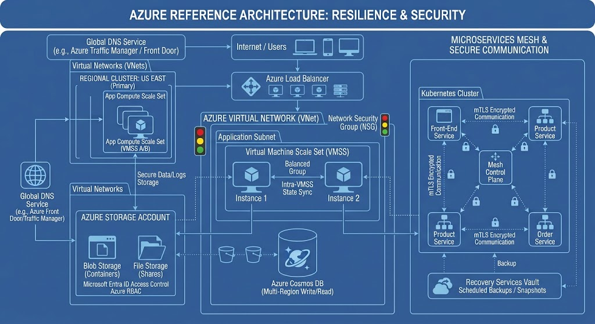
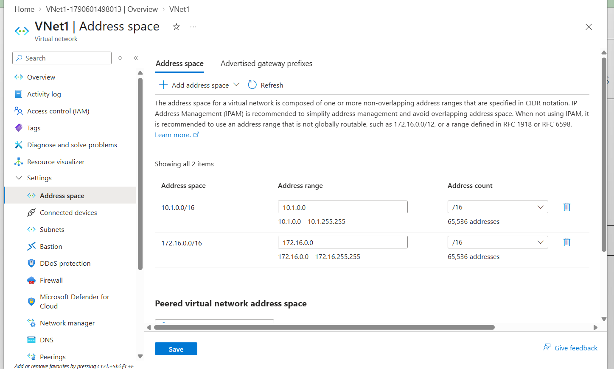
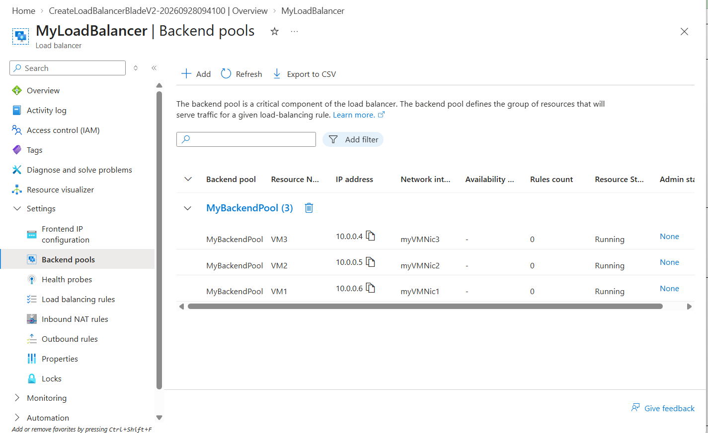

# Azure Highly Available Infrastructure Project

## Overview

This project brings together many important components of Azure infrastructure into one project focused on networking, load balancing, scalability, storage security, and backup and recovery.

The goal was to deploy and configure Azure services that support reliable application connectivity, controlled access to cloud resources, workload scalability, and data protection.

The project includes Azure Virtual Networking, Azure Load Balancer, Azure Storage access management, Virtual Machine Scale Sets, and Azure Backup.

## Project Objectives

* Implement Azure virtual networking and subnet configuration.
* Configure an Azure Load Balancer to distribute traffic across backend resources.
* Manage access to Azure Storage using appropriate identity and access controls.
* Deploy Virtual Machine Scale Sets to support scalable workloads.
* Configure Azure Backup to protect supported virtual machines.
* Document the implementation with Azure Portal screenshots and architecture diagrams.

## Architecture

The following diagram provides a conceptual overview of the solution.

The architecture illustrates how users can access an application through a load balancer, how virtual machines operate within a virtual network, and how storage access and backup can be managed through separate Azure services.

The final architecture should reflect the actual resource configuration documented in the screenshots.

## Technologies Used

* Microsoft Azure
* Azure Virtual Network (VNet)
* Azure Subnets
* Network Security Groups (NSGs)
* Azure Load Balancer
* Azure Virtual Machines
* Azure Virtual Machine Scale Sets (VMSS)
* Azure Storage Accounts
* Microsoft Entra ID
* Azure Role-Based Access Control (RBAC)
* Azure Backup
* Recovery Services vault
* Azure Portal

## Implementation

### 1. Azure Virtual Networking

**Objective:** Establish the network foundation for the Azure infrastructure.

**Implementation areas:**

* Virtual network configuration
* Subnet configuration
* Network Security Group rules
* Network connectivity and traffic control

**Purpose:**

The virtual network provides network isolation and connectivity for supported Azure resources. Subnets help organize resources, while NSGs control permitted inbound and outbound traffic according to configured security rules.

**Evidence:** 

### 2. Azure Load Balancer

**Objective:** Distribute incoming traffic across configured backend resources.

**Implementation areas:**

* Load Balancer configuration
* Frontend IP configuration
* Backend pool configuration
* Health probes and load-balancing rules, where configured

**Purpose:**

Azure Load Balancer distributes network traffic across eligible backend instances according to its configured rules and health probes.

This helps improve application availability when the backend architecture and health-check configuration are designed appropriately.

**Evidence:** 

### 3. Azure Storage Access Management

**Objective:** Control access to Azure Storage resources.

**Implementation areas:**

* Storage Account configuration
* Identity and access management
* Azure RBAC role assignments
* Storage access verification, where performed

**Purpose:**

Microsoft Entra ID and Azure RBAC can be used to grant appropriate permissions to users, groups, or applications.

Following the principle of least privilege helps ensure that identities receive only the permissions required for their responsibilities.

Storage authentication, authorization, and network access restrictions are separate controls and should be documented according to the configuration actually implemented.

**Evidence:** 

### 4. Azure Virtual Machine Scale Sets

**Objective:** Deploy a scalable group of virtual machine instances.

**Implementation areas:**

* VM Scale Set configuration
* Instance deployment and management
* Scaling configuration, where enabled
* Load Balancer integration, where configured

**Purpose:**

Virtual Machine Scale Sets support the deployment and management of groups of virtual machines. Depending on the configuration, they can support horizontal scaling and improved availability.

Availability zones, autoscaling rules, and load-balancing integration should be documented only when configured and verified.

**Evidence:** 

### 5. Azure Backup

**Objective:** Protect supported virtual machines and support recovery.

**Implementation areas:**

* Recovery Services vault configuration
* Backup policy configuration
* Protected resource configuration
* Backup job and recovery-point verification

**Purpose:**

Azure Backup provides data protection for supported Azure workloads. A configured backup policy defines relevant backup and retention settings.

Successful backup jobs and available recovery points provide evidence that the configured protection workflow is operating as expected.

**Evidence:** 

## Architecture Diagrams

* https://github.com/Khudadad-Cloud/azure-high-availability-infrastructure/blob/main/diagrams/azure-architecture.png.jpg
* https://github.com/Khudadad-Cloud/azure-high-availability-infrastructure/blob/main/diagrams/network-traffic-flow.png.jpg
* https://github.com/Khudadad-Cloud/azure-high-availability-infrastructure/blob/main/diagrams/storage-and-backup.png.jpg
* **Evidence:** 

## Screenshots and Evidence

## Screenshots

The following screenshots demonstrate the deployment and configuration of the Azure infrastructure components in this project. They provide evidence of the implemented networking, load balancing, storage security, scalability, and backup solutions.

### 1. Azure Virtual Networking

Shows the Azure virtual network, subnets, and network configuration.

https://github.com/Khudadad-Cloud/azure-high-availability-infrastructure/blob/main/screenshots/vnet.png

### 2. Azure Load Balancer

Shows the Azure Load Balancer configuration used to distribute incoming traffic across backend resources.

https://github.com/Khudadad-Cloud/azure-high-availability-infrastructure/blob/main/screenshots/loadbalancer.png

### 3. Azure Storage Access Management

Shows the storage account configuration and access controls used to manage access to Azure Storage.

https://github.com/Khudadad-Cloud/azure-high-availability-infrastructure/blob/main/screenshots/Screenshot%202026-09-26%20085753.png

### 4. Azure Virtual Machine Scale Sets

Shows the Virtual Machine Scale Set configuration supporting scalability and high availability.

https://github.com/Khudadad-Cloud/azure-high-availability-infrastructure/blob/main/screenshots/Screenshot%202026-09-26%20093304.png

### 5. Azure Backup

Shows the Azure Backup configuration for protecting virtual machines and supporting recovery.

https://github.com/Khudadad-Cloud/azure-high-availability-infrastructure/blob/main/screenshots/Screenshot%202026-10-07%20081211.png
https://github.com/Khudadad-Cloud/azure-high-availability-infrastructure/blob/main/screenshots/Screenshot%202026-10-07%20082419.png

## Skills Demonstrated

* Azure networking and subnet design
* Network Security Group configuration
* Load-balancing concepts
* Virtual machine infrastructure management
* Virtual Machine Scale Set deployment
* Identity and access management
* Azure RBAC and least-privilege principles
* Backup policy configuration
* Backup job and recovery-point verification
* Cloud infrastructure troubleshooting
* Technical documentation

## Project Outcome

This project consolidates five Azure infrastructure implementations into a single documented portfolio project.

It demonstrates practical work with Azure networking, traffic distribution, scalable compute, storage access management, and backup and recovery.

The screenshots and diagrams provide supporting evidence of the implemented configurations.

## Future Improvements

Potential enhancements include:

* Automating infrastructure deployment using Terraform.
* Testing load-balancer health probes and backend failover.
* Testing autoscaling rules and recording the results.
* Reviewing storage network restrictions and identity permissions.
* Performing a test recovery to validate backup recoverability.

  
